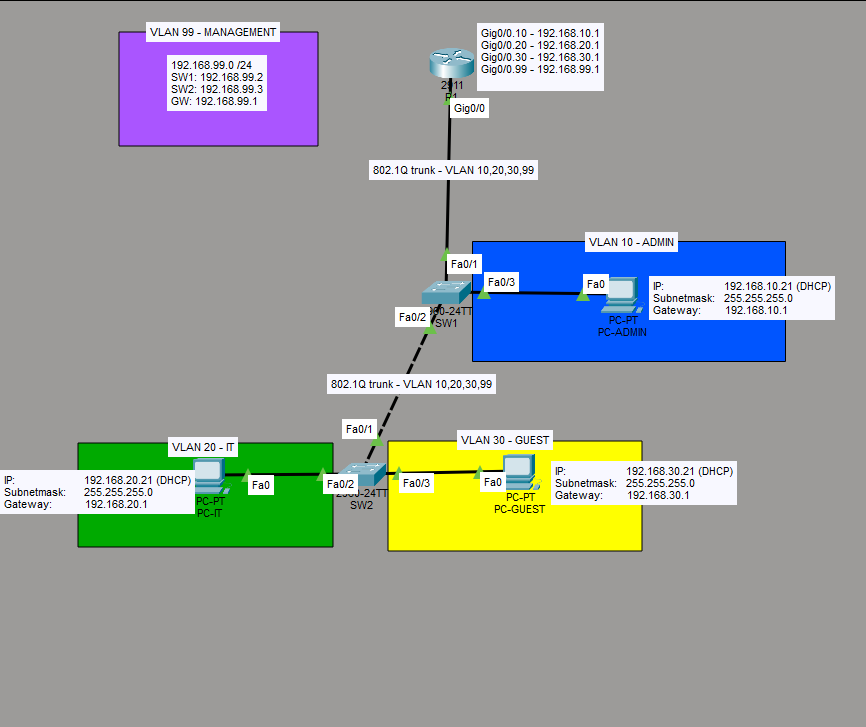

# Enterprise Network Lab

## Overview
A small enterprise network built in Cisco Packet Tracer to demonstrate
VLAN segmentation, inter-VLAN routing, DHCP, trunking and ACLs, followed
by a hardening phase with secure device management and Layer 2 security.

## Topology
- 1 router (Cisco 2911)
- 2 switches (Cisco 2960)
- 4 end devices: PC-ADMIN, PC-IT, PC-GUEST and PC-MGMT

## VLAN Design

| VLAN | Name       | Network         | Purpose                      |
|------|------------|-----------------|------------------------------|
| 10   | ADMIN      | 192.168.10.0/24 | Administration users         |
| 20   | IT         | 192.168.20.0/24 | IT department                |
| 30   | GUEST      | 192.168.30.0/24 | Guest users, restricted      |
| 99   | MANAGEMENT | 192.168.99.0/24 | Device management            |
| 998  | PARKING    | -               | Unused switch ports          |
| 999  | NATIVE     | -               | Unused native VLAN on trunks |

## Technologies

### Core network
- Cisco IOS CLI
- IEEE 802.1Q trunking
- Router-on-a-stick inter-VLAN routing
- DHCP server on the router
- Extended named ACL for guest isolation

### Hardening
- SSH v2 with local user authentication (Telnet disabled)
- Management access restricted to VLAN 99 with a VTY ACL
- Encrypted secrets and login banner
- Trunk security: dedicated native VLAN, DTP disabled
- Unused ports shut down and moved to a parking VLAN
- Port security with sticky MAC addresses
- DHCP snooping with rate limiting
- Dynamic ARP Inspection

## Troubleshooting Example
After the guest ACL was applied, PC-GUEST could no longer obtain an
address via DHCP. DHCP Discover messages are sent from 0.0.0.0, which
did not match the ACL's permit for 192.168.30.0/24. Fixed by adding
`permit udp any any eq bootps`. See `docs/test-results.md`.

## Verification
See `docs/test-results.md` for all test results.

## Project Files
- `enterprise-network-lab.pkt` - Packet Tracer project
- `configs/` - Device running configurations
- `diagrams/` - Network topology diagram
- `docs/` - Network design and test documentation
- `screenshots/` - Evidence of configuration and testing

## Versions
- `v1.0` - VLANs, trunking, router-on-a-stick, DHCP, guest ACL, port security
- `v2.0` - Device and Layer 2 hardening

## Status
Core network and hardening implemented and verified.